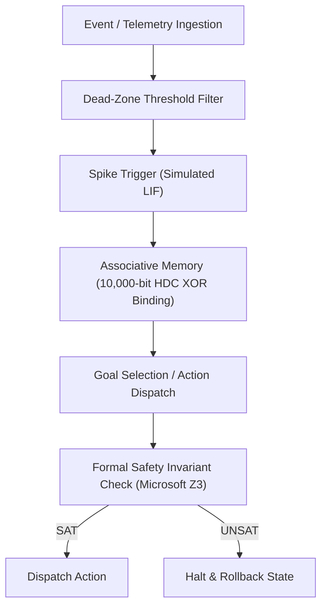

# Veda-OS: Experimental Neuro-Symbolic Research Framework 🛡️

[](LICENSE)
[](https://www.python.org/)
[](https://github.com/Z3Prover/z3)
[](#project-status)

An educational and experimental prototype exploring **neuro-symbolic integration**, combining event-driven reflex concepts (LIF SNN, linear state scans, hyperdimensional computing) with deterministic mathematical verification using the **Microsoft Z3 SMT Solver**.

---

## 📌 Project Status & Engineering Transparency

> [!IMPORTANT]
> **What this project IS:**
> - A functional architectural prototype and design harness.
> - A testbed for integrating formal methods (`z3-solver`) into event-driven decision loops.
> - A clean-room study of frontier AI agent patterns (tool orchestration, memory bundling, and permission gates).

> [!WARNING]
> **What this project IS NOT:**
> - It is **not** a standalone operating system kernel (it does not contain low-level OS drivers or hardware process isolation).
> - It does **not** replace large frontier language models (model profiles represent behavioral schemas and hypervector embeddings, not trained multi-billion parameter neural network weights).
> - It is **not** a production binary decompiler (the reverse-engineering module is a heuristic disassembler and templated repository scaffold generator).

---

## 🏛️ Architectural Concepts Under Exploration



1. **Layer 1: Telemetry & Signal Filtering:** Basic dead-zone suppression to filter background noise.
2. **Layer 2: Event Reflex:** Leaky Integrate-and-Fire (LIF) thresholding and selective linear scanning.
3. **Layer 3: Akasha HDC Memory:** Hyperdimensional Computing (10,000-bit random vectors with XOR binding and bundling) for constant-time associative pattern recall.
4. **Layer 4: GOAP Planning:** Goal-oriented action tree evaluation based on confidence and cost heuristics.
5. **Layer 5: Vajra Verification:** Real **Microsoft Z3 SMT Theorem Prover** checking solvency bounds and AST invariants before execution.
6. **Layer 6: Karma Execution:** Checkpointed state dispatch with rollback handling on invariant failure.
7. **Layer 7: Decoupled Boundary:** Modular interface for external tooling, sandboxed execution, and analysis pipelines.

---

## 🧪 Current Prototype Modules

* **`veda_7layer_core.py`** — Unified Python prototype demonstrating the end-to-end 7-layer control loop.
* **`veda_windows_sentinel_v2.py`** — Host monitoring script reading real Windows metrics (`psutil`) with SHA-256 tamper-evident audit logging.
* **`veda_reverse_engineer.py`** — Heuristic binary header inspection, Shannon entropy calculator, and scaffold generator.
* **`step1_benchmark.py` – `step5_closed_loop_demo.py`** — Unit benchmarks covering latency percentiles and Z3 constraint checks.
* **`src/` & Web Console** — React/Vite dashboard illustrating the live multi-stage telemetry interface.

---

## 🚀 Running the Prototype

### Prerequisites
- Python 3.11+
- Node.js 20+ (for the optional web dashboard)

### Setup & Execution
```bash
# 1. Install Python dependencies
pip install z3-solver psutil

# 2. Run the core neuro-symbolic simulation loop
python veda_7layer_core.py

# 3. Run the live Windows OS sentinel
python veda_windows_sentinel_v2.py
```

---

## 📄 License
This project is open-source under the [MIT License](LICENSE).
