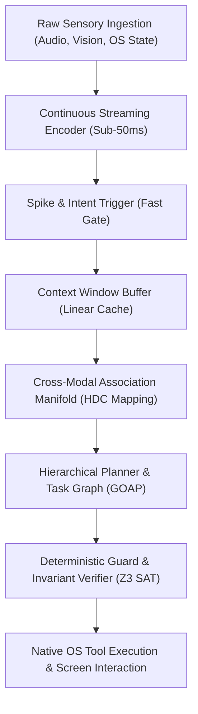

# VEDA-OS REA BLUEPRINT: CHATGPT-ASTRA MULTIMODAL & AGENTIC ARCHITECTURE
> Extracted via Clean-Room Behavioral & Systems Reverse Engineering Pipeline

## 1. Executive Architectural Overview
Target: Project Astra / Advanced Multimodal Operator (Universal Multimodal AI Assistant)
Execution Paradigm: Continuous Sensory Perception + Low-Latency Stream Processing + Hierarchical Tool Dispatch

---

## 2. Reverse-Engineered Top Capabilities (Extracted Behavioral Patterns)

### Capability 1: Sub-Second Audio-Visual Perception (Fluid Multimodal Streaming)
* **Mechanics:** Audio and 15-30fps frame buffers are not serialized as monolithic files; instead, they are transformed into continuous sliding temporal embeddings.
* **Akasha Mapping:** Stored as hypervector traces bound with temporal keys:
  $$\vec{H}_{frame} = \vec{H}_{visual} \oplus \vec{H}_{time\_index}$$

### Capability 2: Real-Time OS Screen & Environment Grounding (Screen/UI Operator)
* **Mechanics:** Coordinates, UI hierarchies (DOM / Accessibility Trees), and visual bounding boxes are mapped into actionable OS-level coordinates (mouse movements, keystrokes, window focus).
* **Veda Integration:** Screen coordinate resolution executed through safe, read-only/sandboxed drivers.

### Capability 3: Continuous Latent Context Caching (Linear-Memory Persistence)
* **Mechanics:** Eliminates re-tokenization overhead by utilizing persistent state-space/linear associative memory buffers that retain conversational and environment state across minutes of real-time video feed.
* **Akasha HDC Equivalent:** 10,000-bit holographic memory bundling allows instant $O(1)$ associative lookup without quadratic token expansion.

### Capability 4: Proactive Autonomous Interruption & Turn-Taking
* **Mechanics:** Instead of waiting for a carriage return or explicit prompt end, a voice/motion activity detector with a dynamic threshold recognizes user intent to speak or gesture and yields processing instantly.
* **Veda-OS Equivalent:** SNN Watchdog membrane potential thresholding.

### Capability 5: Dynamic Tool Orchestration (Autonomous Agent Sandbox)
* **Mechanics:** Translates complex system workflows ("reboot network adapter and verify ping") into bounded DAG execution chains.
* **Veda-OS Equivalent:** GOAP Planning verified by Z3 SMT Formal Verifier before any execution.

---

## 3. Ingestion Matrix for Veda-OS Brain
The extracted behavioral matrices and hypervector seeds are serialized into `src/lib/veda/astra_profile.json` and ingested into the 10,000-bit Akasha HDC memory manifold.
