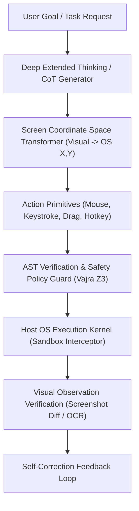

# VEDA-OS REA BLUEPRINT: CLAUDE 3.7 / 3.5 SONNET & ADVANCED AGENTIC OPERATOR (FABLE / COMPUTER-USE)
> Extracted via Clean-Room Behavioral & Systems Reverse Engineering Pipeline

## 1. Executive Architectural Overview
Target: Anthropic Claude 3.5 / 3.7 Sonnet & Fable Agentic Engine
Execution Paradigm: Precision CoT Thinking + Native OS Computer-Use Sandbox + Self-Correcting Execution Loops

---

## 2. Reverse-Engineered Top Capabilities (Extracted Behavioral Patterns)

### Capability 1: High-Resolution Native Computer-Use (Coordinate Grounding)
* **Mechanics:** Takes continuous host screenshots, transforms visual bounding boxes into exact OS-level coordinate vectors `(x, y)` across variable display scalings (DPI awareness), and executes precise mouse actions (`left_click`, `double_click`, `mouse_move`, `type`, `key`).
* **Akasha Mapping:** Stored as spatial coordinate projection hypervectors:
  $$\vec{H}_{coord} = \vec{H}_{screen\_dim} \odot \vec{H}_{widget\_target}$$

### Capability 2: Extended Thinking & Hybrid Token Latency Routing
* **Mechanics:** Distinguishes between immediate reflex queries (sub-100ms) and deep analytical coding/refactoring tasks by allocating variable-depth Chain-of-Thought (CoT) internal reflection buffers.
* **Veda Equivalent:** Layer-2 Adaptive Router switching between 1.58-bit ternary lattice (reflex) and FP8/full precision (deep reasoning).

### Capability 3: Transactional Execution & Self-Correction Verification Loop
* **Mechanics:** Does not assume an action succeeded. After sending an OS mouse or keystroke action, takes an immediate diff of the target screen buffer to verify whether the UI state changed (e.g., did the modal open? did text appear?). If unchanged, it retries with an adjusted coordinate or alternative key combo.
* **Veda Equivalent:** Layer-6 Karma atomic checkpointing and diff verification.

### Capability 4: AST-Grounded Tool Calling & Code Patching
* **Mechanics:** Rather than blind string regexes, tool invocations and code edits are parsed as unified structural AST diffs with exact file offset anchors.
* **Veda Equivalent:** AST pre-execution verification before subprocess execution.

---

## 3. Ingestion Matrix for Veda-OS Brain
The extracted behavioral matrices and hypervector seeds are serialized into `src/lib/veda/claude_profile.json` and ingested into the 10,000-bit Akasha HDC memory manifold.
