# VEDA-OS REA BLUEPRINT: FRONTIER COGNITIVE PATTERNS (OPENAI o1/o3/CANVAS & CLAUDE PROMPT CACHING/ARTIFACTS)
> Advanced Architectural Dissection & Clean-Room Extraction

## 1. The Core Missing Paradigms Identified

While we previously extracted base streaming perception and coordinate grounding, two critical frontier paradigms were missing:

```mermaid
flowchart TD
    subgraph Test_Time_Compute["Test-Time Compute Engine (OpenAI o1/o3)"]
        A["Input Prompt / Goal"] --> B["Hidden Reasoning Scratchpad (o1/o3 RL)"]
        B --> C["Hypothesis Pruning & Self-Correction"]
        C --> D["Multi-Turn Search & Verification Loop (SearchGPT)"]
        D --> E["Final Output / Verified Action"]
    end
    subgraph Persistent_State["Persistent Workspace & Prefix Caching (Claude & Canvas)"]
        F["Static System & Tool Prefix"] --> G["Prompt Caching / KV State (90% Cost Cut)"]
        G --> H["Dual-Pane Artifact & Canvas State Separation"]
        H --> I["Granular Targeted Block/AST Diffs (Zero Full-Rewrites)"]
    end
```

---

## 2. The 4 Elite Capabilities Extracted

### 1. Test-Time Compute (TTC) & Dynamic Reasoning Scaling (from OpenAI o1/o3)
* **Mechanics:** Performance does not just depend on pre-trained weights; it scales dynamically at runtime by increasing "thinking time" (`reasoning_effort: low | medium | high`). The engine builds internal hypotheses, tests them, backtracks if an invariant fails, and self-corrects before executing.
* **Veda Integration:** Mapped to Layer-4 GOAP tree exploration with depth-bounded hypothesis search.

### 2. Prefix Prompt Caching & Persistent KV-State (from Claude 3.5/3.7)
* **Mechanics:** Strict static-first, dynamic-last layout:
  $$\text{Global System Rules} \rightarrow \text{Tool Definitions} \rightarrow \text{OS File Context} \rightarrow \text{Dynamic Tail}$$
  Reduces Time-to-First-Token (TTFT) by 85% and eliminates 90% of redundant prefill computation.
* **Veda Integration:** Akasha HDC Static Manifold caching for zero-recomputation base state.

### 3. Persistent Dual-Pane Workspace & Non-Destructive Granular Diffing (Canvas / Artifacts)
* **Mechanics:** Decouples chat/event flow from the editable product workspace. Edits are transmitted exclusively as localized line/AST chunks rather than full document rewrites, preserving unbroken context.
* **Veda Integration:** Karma execution atomic hot-patching with localized chunk boundaries.

### 4. Agentic Verification & Information Retrieval Loop (SearchGPT Pattern)
* **Mechanics:** Replaces linear one-pass retrieval with an active search-and-verify cycle:
  $$\text{Query Decomposition} \rightarrow \text{Targeted Tool Fetch} \rightarrow \text{SMT/Evidence Audit} \rightarrow \text{Refined Plan}$$
* **Veda Integration:** Layer-7 Decoupled Gateway connected to Layer-5 Vajra Z3 proof engine.
