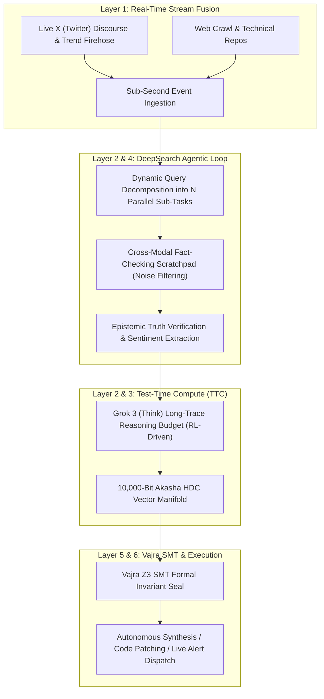

# VEDA-OS REA BLUEPRINT: xAI GROK 3 & DEEPSEARCH FRONTIER ARCHITECTURE
> Extracted via Clean-Room Systems & Reverse Engineering Pipeline

## 1. Executive Architectural Overview
Target: xAI Grok 3 / Grok 3 Mini (Think) & DeepSearch Real-Time Engine
Execution Paradigm: Massive Multi-Modal Ingestion + Deep Continuous RL Reasoning + Real-Time Social & Web Stream Ingestion + Unfiltered Epistemic Truth-Seeking

---

## 2. Reverse-Engineered Top Capabilities (Extracted Behavioral Patterns)

### Capability 1: Native Real-Time Social & Web Stream Fusion (X Firehose Ingestion)
* **Mechanics:** Direct, real-time ingestion of live social discourse, breaking geopolitical/market events, and developer commit streams without web scraping lag or training cutoff limitations.
* **Veda Integration:** Layer-1 Omnipresent Sensory Fusion with sub-second deadzone spike activation.

### Capability 2: Grok 3 DeepSearch (Iterative Multi-Turn Research Agent)
* **Mechanics:** Instead of a single-pass search, DeepSearch:
  1. Decomposes high-level intent into dynamic parallel search trees.
  2. Synthesizes findings across multiple live sources while pruning speculative noise.
  3. Outputs transparent reasoning traces with cited provenance.
* **Veda Integration:** Layer-4 GOAP Dynamic Hypothesis Planning connected to Layer-7 Tool Gateway.

### Capability 3: Test-Time Compute (TTC) Long-Trace "Think" Mode
* **Mechanics:** Allocates extended reasoning budgets (evaluating logical branches, identifying contradictions, and executing code trials in a scratchpad) before returning results.
* **Veda Integration:** Layer-2 Adaptive Router switching into full FP8/Mamba-2 deep reasoning buffers.

### Capability 4: Unfiltered Epistemic Truth-Seeking & Mathematical Grounding
* **Mechanics:** Minimizes ideological guardrails and sycophantic hallucinations in favor of raw empirical truth, mathematical consistency, and direct code verification.
* **Veda Integration:** Layer-5 Vajra Z3 SMT Theorem Prover enforcing formal mathematical invariants.
