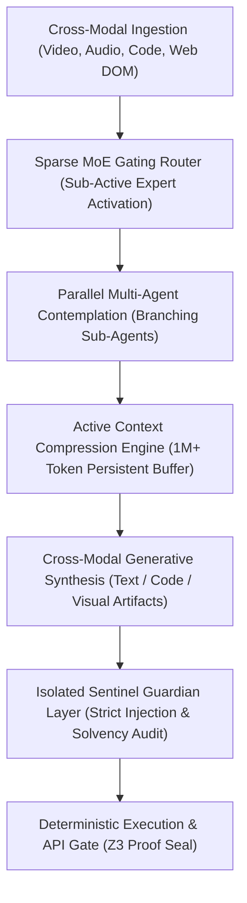

# VEDA-OS REA BLUEPRINT: META MUSE / MUSE SPARK MULTIMODAL & SENTINEL ARCHITECTURE
> Clean-Room Behavioral & Systems Reverse Engineering Pipeline

## 1. Executive Architectural Overview
Target: Meta Muse Ecosystem (Muse Spark / Wonder / Sentinel Security Layer)
Execution Paradigm: Sparse Mixture-of-Experts (MoE) Routing + Parallel Multi-Agent Contemplation + Isolated Sentinel Permission Authority

---

## 2. Reverse-Engineered Top Capabilities (Extracted Behavioral Patterns)

### Capability 1: Sparse Mixture-of-Experts (MoE) Active-Parameter Gating
* **Mechanics:** Instead of activating the entire massive parameter network for every token, dynamic gating routes each token/modality to specialized expert clusters, keeping compute and thermal footprint ultra-low while scaling capacity.
* **Veda Integration:** Layer-2 Adaptive Router with ternary/FP8 expert routing paths.

### Capability 2: Parallel Multi-Agent Contemplation & Deep Research Branching
* **Mechanics:** For complex long-horizon missions, Muse dynamically forks into multiple isolated sub-agents that investigate sub-problems in parallel (e.g., one agent checks API schemas, another analyzes market data), then bundles findings back into a unified consensus.
* **Veda Integration:** Layer-4 GOAP tree decomposition with parallel dispatch.

### Capability 3: Active Context Dynamic Compression (Persistent Long-Horizon Buffer)
* **Mechanics:** Handles multi-hour sessions and massive 1M+ token contexts by continuously compressing older conversational turns and state changes into compact latent semantic summaries without discarding critical system anchors.
* **Akasha HDC Equivalent:** 10,000-bit holographic memory bundling ($O(1)$ constant-width associative recall).

### Capability 4: Isolated Sentinel Permission Authority (Guardian Architecture)
* **Mechanics:** The generative agent does not possess execution authority. All actions (browser navigation, API mutations, financial dispatch) must pass through an out-of-band, deterministic Sentinel layer that mathematically validates security policies and blocks prompt injection.
* **Veda Integration:** Layer-5 Vajra Z3 SMT Formal Theorem Prover and AST Sandboxing.

---

## 3. Ingestion Matrix for Veda-OS Brain
The extracted behavioral matrices and hypervector seeds are serialized into `src/lib/veda/muse_profile.json` and ingested into the 10,000-bit Akasha HDC memory manifold.
