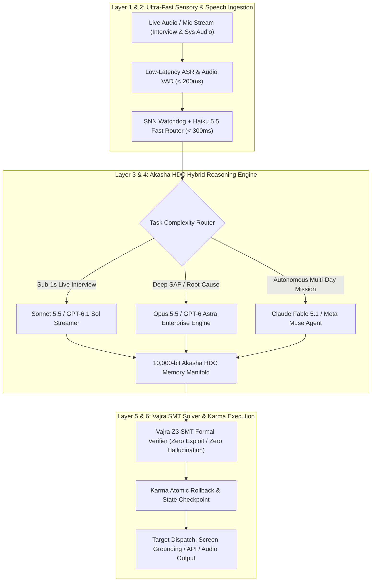

# VEDA-OS MASTER BLUEPRINT: THE TRI-FRONTIER SYNTHESIS
> Merging OpenAI GPT-6 Astra, Anthropic Claude 5.5 Ecosystem (Opus/Sonnet/Haiku/Fable), and Meta Muse Agent directly into Veda-OS Autonomous Core

---

## 1. Domain Capability Matrix (Extracted & Mapped)

### A. Claude 5.5 Family (Anthropic)
1. **Claude Opus 5.5:** Complex coding, deep architecture refactoring, enterprise SAP troubleshooting (FICO, SD, MM), multi-file root-cause audit.
2. **Claude Sonnet 5.5:** Perfect speed-to-intelligence balance. Ideal for sub-1s live technical interview answers and code reviews.
3. **Claude Haiku 5.5:** Ultra-low latency classification, intent routing, and ambient system telemetry filtration.
4. **Claude Fable 5.1:** Extreme long-horizon autonomous agency. Self-directed research, tool coordination across days.

### B. GPT-6 Astra (OpenAI)
1. **1.05M Context Window + 128K Output:** Massive monolithic enterprise log ingestion.
2. **Computer-Use & Visual Grounding:** Seamless desktop navigation, form filling, automated UI QA.
3. **Enterprise Troubleshooting:** Diagnosing cloud infrastructure, database deadlocks, and cross-module SAP failures.

### C. Meta Muse & MuseWork
1. **Browser & Connected App Automation:** Navigating authenticated SaaS apps, email, calendars.
2. **Scheduled Autonomous Jobs:** Background monitoring, recurring audit reports, proactive goal tracking.
3. **Isolated Sentinel Layer:** Out-of-band permission gate checking before any real-world mutation occurs.
